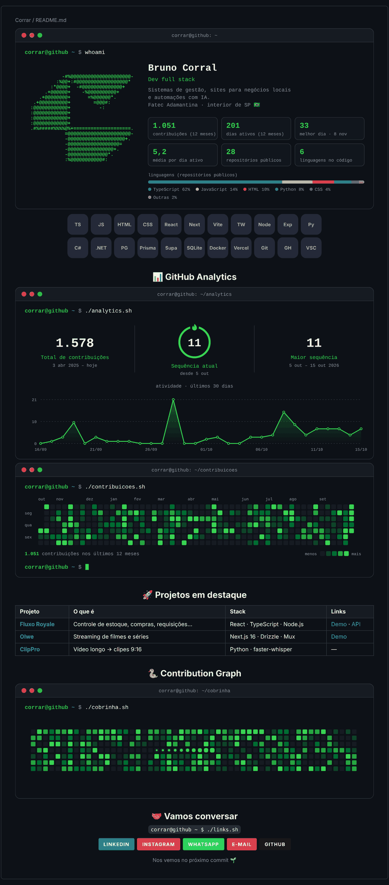
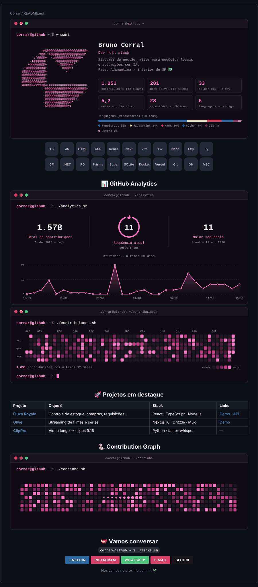

<div align="center">

# 🧹 Ajust-github

**Kit para organizar e deixar mais bonito o GitHub [@Corrar](https://github.com/Corrar).**

Auditoria dos 63 repositórios · plano repo a repo · script que aplica tudo · README de perfil · padrões e modelos

</div>

---

## 📦 O que tem aqui

```
Ajust-github/
├── docs/
│   ├── AUDITORIA.md             # diagnóstico + o que fazer com cada repositório
│   ├── PADROES.md               # regras para a bagunça não voltar
│   ├── SKILLS-E-FERRAMENTAS.md  # plugins do Claude e ferramentas recomendadas
│   └── previa/                  # como o perfil fica (temas verde e rosa)
├── organizar/
│   ├── repos.json               # o plano: descrição, tópicos, arquivar, privar, excluir
│   └── organizar.py             # aplica o plano com o GitHub CLI (simula por padrão)
├── perfil/                      # README de perfil estilo terminal
│   ├── README.md
│   ├── scripts/gerar_cards.py   # desenha os cards com os seus dados do GitHub
│   └── .github/workflows/       # Action que atualiza os cards todo dia
└── modelos/
    ├── README-projeto.md        # modelo de README para os projetos
    ├── readmes/                 # READMEs prontos para colar (Fluxo Royale)
    ├── dot-github/              # modelos de issue e PR para todos os repositórios
    └── dependabot.yml           # atualização automática de dependências
```

## 🚀 Passo a passo

### 1. Revise o plano

Leia o [**diagnóstico**](docs/AUDITORIA.md) e ajuste o que quiser no
[`organizar/repos.json`](organizar/repos.json). Os repositórios privados que
não puderam ser lidos estão com `"descricao": null` — preencha se quiser.

### 2. Instale e autentique o GitHub CLI

```bash
winget install --id GitHub.cli   # Windows (ou veja https://cli.github.com)
gh auth login
```

### 3. Rode o script

Funciona no Windows, Linux e macOS (Python 3.8+, sem dependências).

```bash
python organizar/organizar.py                         # 1º: SIMULA e mostra cada comando
python organizar/organizar.py --aplicar               # descrições, tópicos, privar e arquivar
python organizar/organizar.py --aplicar --renomear    # opcional: nomes em kebab-case
python organizar/organizar.py --aplicar --excluir     # opcional: exclui os vazios, pedindo confirmação
python organizar/organizar.py --so ClipPro            # só um repositório
```

O script pode ser rodado de novo sem problema: pula o que já foi arquivado e o que
já foi renomeado. Para excluir, o `gh` precisa de permissão extra:
`gh auth refresh -h github.com -s delete_repo`.

> **Depois de renomear**, o GitHub redireciona os links antigos (inclusive os do
> README de perfil), mas atualize o clone local:
> `git remote set-url origin https://github.com/Corrar/<novo-nome>.git`

### 4. Publique o README de perfil

| Tema verde (padrão) | Tema rosa |
|---|---|
|  |  |

<sub>Prévia com números fictícios; no seu perfil entram os seus dados reais.</sub>

Os cards no estilo terminal (`whoami`, analytics, mapa de contribuições e
cobrinha) são **gerados pela sua própria Action** com os dados da API do GitHub,
sem depender de sites de terceiros que vivem caindo. Ela roda a cada push e
uma vez por dia.

**Antes de publicar**, complete:

- os links de contato marcados com `EDITE` no [`perfil/README.md`](perfil/README.md);
- nome, cargo e bio no topo de [`perfil/scripts/gerar_cards.py`](perfil/scripts/gerar_cards.py) (bloco `PERFIL`).

O perfil só mostra um README se ele estiver num repositório **público** com o
mesmo nome do usuário. Rode na pasta onde está o clone do `Ajust-github`:

```bash
gh repo create Corrar --public --description "README do meu perfil"
git clone https://github.com/Corrar/Corrar.git
cp -r Ajust-github/perfil/. Corrar/        # no PowerShell: Copy-Item -Recurse -Force Ajust-github\perfil\* Corrar\
cd Corrar
git add . && git commit -m "feat: README de perfil" && git push
```

Espere a Action **Atualizar perfil** terminar (aba *Actions*, cerca de 1 minuto).
Até lá, as imagens aparecem quebradas.

- **Trocar o tema**: mude `TEMA: verde` para `TEMA: rosa` em `.github/workflows/perfil.yml`.
- **Contar também o trabalho em repositórios privados** (o Fluxo 5.0, por exemplo):
  no seu perfil, *Contribution settings → Private contributions*. Sem isso, os
  números só mostram o que é público.
- **Logo em ASCII**: sai do seu avatar do GitHub. Se trocar o avatar, o card acompanha.
- **Testar no seu computador**: `python scripts/gerar_cards.py --demo --saida previa`
  gera os cards com dados fictícios, sem precisar de token.

### 5. Fixe os 6 destaques

No seu perfil → **Customize your pins** → marque **Fluxo-Royale-Frontend**,
**Olwe-Studio**, **ClipPro**, **otica-rinopolis**, **GringoPizzaria-Front** e **COL-Front**.

### 6. Opcional: modelos de issue e PR para todos os repositórios

```bash
gh repo create .github --public --description "Modelos padrão de issue e PR"
git clone https://github.com/Corrar/.github.git
cp -r Ajust-github/modelos/dot-github/. .github/
cd .github && git add . && git commit -m "feat: modelos de issue e PR" && git push
```

### 7. Complete os READMEs

- **Fluxo-Royale-Frontend**: cole o rascunho de [`modelos/readmes/fluxo-royale-frontend.md`](modelos/readmes/fluxo-royale-frontend.md)
- **Sem README ou com o padrão do Lovable**: SummerDrinks_Atendimento, DashProject-Frontend,
  Hub-Academico e garcas-burguer — use o [`modelos/README-projeto.md`](modelos/README-projeto.md)

## 📐 Para não bagunçar de novo

O resumo do [guia de padrões](docs/PADROES.md):

1. **Ajuste vira branch, versão vira tag** — nada de repositório `fim`, `att` ou `projeto2.1`
2. Nome em `kebab-case`, descrição de uma frase, 5 a 10 tópicos
3. README com print, demo e "como rodar"
4. `.env` nunca vai para o Git
5. Terminou? Arquive.
